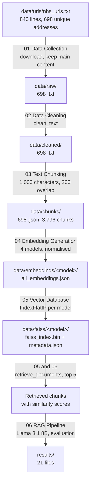

# The research pipeline

How the original dissertation notebooks turn NHS web pages into searchable vectors, and what
the files in `Healthcare_RAG/` show about it. This is the reference for Part 2, where the web
application starts reusing the pipeline.

Checked on 2 November 2026 against the archive, with `backend/tests/test_research_pipeline.py`
(see [How to re-run the checks](#how-to-re-run-the-checks)). The archive was only read; nothing
in `Healthcare_RAG/` was run, rebuilt or changed.

## How to read this document

Each statement comes from one of three sources:

| Label | Meaning |
|---|---|
| **Verified** | A check in `test_research_pipeline.py` confirms it against the files |
| **From the code** | Read in the notebook source; not executed here |
| **From saved output** | Printed by a notebook when it was run, and saved in the `.ipynb` file |

The checks show that the files are **consistent with** the notebook code. They do not show
which run of a notebook produced a given file; where that matters it is stated.

Cells are numbered from 0 in file order. The notebooks' own "STEP n" headings use different
numbers.

## Overview



| Stage | Notebook | Input | Output | Status |
|---|---|---|---|---|
| Collect | `01_Data_Collection` | address list | 698 raw articles | From the code and saved output; counts verified |
| Clean | `02_Data_Cleaning` | raw articles | 698 cleaned articles | **Verified**: reproduced byte for byte |
| Chunk | `03_Text_Chunking` | cleaned articles | 3,796 chunks | **Verified**: consistent with the settings |
| Embed | `04_Embedding_Generation` | chunks | 4 × 3,796 vectors | **Verified**: order, size, unit length |
| Index | `05_Vector_Database_FAISS…` | vectors | 4 FAISS indexes | **Verified**: identical to the vectors |
| Retrieve | `05`, `06_RAG_Pipeline` | a question | top-k chunks | From the code; not run here |

## Where the notebooks ran

From the code: every notebook ran in Google Colab with the project in Google Drive
(`/content/drive/MyDrive/Healthcare_RAG`), installing libraries with `!pip install`. The only
library versions recorded are in notebook 01's saved pip output (Python 3.12, beautifulsoup4
4.13.5, lxml 6.1.1, requests 2.32.4, tqdm 4.67.3). The versions of langchain-text-splitters,
sentence-transformers and faiss-cpu were installed quietly (`-q`) and are **not recorded**,
which matters for reproducing chunking or embeddings exactly (Part 2.1 and 2.2).

What the saved execution records show:

| Notebook | Execution counts | Notes |
|---|---|---|
| 01 | none saved (outputs are) | Cell 7 is not valid Python as saved; see [Discrepancies](#discrepancies) |
| 02 | 1–7, in order | |
| 03 | 2–10, in order | |
| 04 | none saved (outputs are) | Run order cannot be read from the file |
| 05 | 1–7, 9–11, 14–17 | Gaps: cells were re-run or removed |
| 06 | 1–26, 28, then mostly none | Cells 27–42 and 45–47 have no saved output |
| 06 (1) | 1–26, 40, 41, 33–39, then none | Cells 35–47 have no saved output |

## Stage 1: Collect (notebook 01)

From the code (cells 4 and 9):

1. Read `data/urls/nhs_urls.txt`, drop blank lines, change `http://` to `https://`, and
   remove duplicates.
2. Download each page, find its `<main>` element and keep, in order: `h1`/`h2`/`h3` headings
   (written as `#`, `##`, `###`), paragraphs, and list items (written with a `•` bullet),
   skipping any text already seen on that page.
3. Join the pieces with blank lines and save as `data/raw/<title>.txt`, where the file name is
   the page title in lower case with spaces as underscores and other characters removed.

**Verified:** the address file has 840 lines, which reduce to 698 unique addresses by step 1,
and there are 698 raw files. **From saved output:** "Articles Saved : 698, Failed Pages : 0".

The raw files do not record which address they came from (file names come from page titles),
and the date the pages were downloaded is not recorded. This project does not reproduce or
link any of the addresses.

## Stage 2: Clean (notebook 02)

From the code (cell 4), `clean_text` takes an article and:

1. splits it into lines and trims each one,
2. drops empty lines,
3. collapses any run of whitespace inside a line to one space,
4. drops a line if the same line already appeared anywhere earlier in the article,
5. joins the remaining lines with one blank line between them.

Cell 5 applies it to every raw file and writes `data/cleaned/<same name>.txt`.

**Verified:** running a copy of `clean_text` (checked to be identical in structure to cell 4)
on all 698 raw files reproduces all 698 cleaned files **byte for byte**. All raw, cleaned and
chunk files use Unix (LF) line endings.

Step 4 removes repeated lines across the whole article, not just neighbouring ones, so a
heading or sentence that appears twice in a page is kept only the first time.

**Reproduced in the backend** (PRD 2.1): `medquery_api.processing.clean_text` turns all 698
raw articles into the archived cleaned articles byte for byte (`backend/tests/test_processing.py`).

## Stage 3: Chunk (notebook 03)

From the code (cell 5), LangChain's `RecursiveCharacterTextSplitter`:

| Setting | Value |
|---|---|
| `chunk_size` | 1,000 characters (maximum) |
| `chunk_overlap` | 200 characters (maximum) |
| `separators`, tried in order | `"\n## "`, `"\n### "`, `"\n\n"`, `"\n"`, `". "`, `" "`, `""` |

The splitter prefers to break at section headings, then subsection headings, paragraphs,
lines, sentences, words, and finally anywhere. Cell 6 writes one JSON file per article,
`data/chunks/<name>.json`, holding a list of records:

| Field | Meaning |
|---|---|
| `chunk_id` | Position within the article, counting from 1 (not unique across articles) |
| `source_file` | The cleaned file it came from, e.g. `asthma.txt` |
| `chunk_length` | Number of characters in `text` |
| `text` | The chunk |

A chunk is identified uniquely by `source_file` together with `chunk_id`.

**Verified:**

- 3,796 chunks across 698 files; `chunk_id` runs 1, 2, 3… in every file.
- Every `chunk_length` equals the length of its text and is at most 1,000. Shortest 16,
  longest 999, mean 645.59, exactly as notebook 03 printed.
- Every chunk appears, in order, as an exact piece of its cleaned article, with no
  surrounding whitespace.
- Together the chunks cover every non-space character of every article: nothing was lost.
- 316 of the 3,098 pairs of neighbouring chunks overlap, by at most 200 characters; the rest
  share no text.

Why so few overlap (from how LangChain's splitter works, not something the checks test): when
it starts a new chunk, it carries over whole pieces (sections, paragraphs, lines, sentences)
from the end of the previous chunk, and only as many as fit in 200 characters. When the last
piece is longer than that, nothing is carried over.

**Reproduced in the backend** (PRD 2.1): `medquery_api.processing.chunk_article` reimplements
the splitter in plain Python, without LangChain. Applied to the 698 cleaned articles, it gives
all 3,796 archived chunk records exactly: same order, `chunk_id`, `source_file`,
`chunk_length` and text. Starting from the raw articles (cleaning, then chunking) gives the
same result. As a separate diagnostic, writing the records the way notebook 03 did
(`indent=4, ensure_ascii=False`) reproduces all 698 chunk files byte for byte.

This shows the reimplementation matches the LangChain version the notebooks used **on this
data**. Situations the archive does not contain, such as a piece of 1,000 or more characters
with no finer break point, follow the algorithm as written and are covered only by unit tests.

## Stage 4: Embed (notebook 04)

From the code (cells 4–22): all chunks are loaded from the chunk files sorted by file name,
and each model turns every chunk's text into a vector with `normalize_embeddings=True`.

| Name | Model | Vector size | Text given to the model | Batch size |
|---|---|---|---|---|
| MiniLM | `sentence-transformers/all-MiniLM-L6-v2` | 384 | chunk text | 32 |
| MPNet | `sentence-transformers/all-mpnet-base-v2` | 768 | chunk text | 16 |
| E5 | `intfloat/multilingual-e5-base` | 768 | `"passage: "` + chunk text | 16 |
| BGE | `BAAI/bge-small-en-v1.5` | 384 | chunk text | 32 |

Each model's output is saved as `data/embeddings/<name>/all_embeddings.json`: one list of the
chunk records above, each with an added `embedding` (its vector). The stored text never
includes the E5 `passage: ` prefix.

**Verified for each model:**

- 3,796 records with the same chunk fields, in the same order, as the chunk files.
- Every vector has the size in the table.
- Every vector has length 1 within a tolerance of 0.0001. The tolerance comes from float32
  precision: rounding while normalising can shift a length by up to about vector size × 2⁻²⁴
  (768 × 6×10⁻⁸ ≈ 4.6×10⁻⁵). The measured deviations are far smaller:

  | Model | Largest difference from 1 | Mean difference | Exactly 1 |
  |---|---|---|---|
  | MiniLM | 1.345×10⁻⁷ | 3.738×10⁻⁸ | 0 of 3,796 |
  | MPNet | 1.494×10⁻⁷ | 4.091×10⁻⁸ | 0 of 3,796 |
  | E5 | 1.630×10⁻⁷ | 4.059×10⁻⁸ | 0 of 3,796 |
  | BGE | 1.451×10⁻⁷ | 3.877×10⁻⁸ | 0 of 3,796 |

  Lengths are computed in double precision from the stored float32 numbers. None is exactly 1,
  which is normal for float32 data; all are within tolerance. This shows the vectors have unit
  length, consistent with `normalize_embeddings=True`; it does not show which setting or model
  component did the normalising.

## Stage 5: Index (notebook 05)

From the code (cells 5–6): for each model, the vectors are added, in file order, to a FAISS
`IndexFlatIP`, saved as `data/faiss/<name>/faiss_index.bin`. The chunk records without vectors
are saved alongside as `metadata.json`.

`IndexFlatIP` is an exact (brute-force) index that scores by inner product. Because the
vectors have length 1, the inner product equals cosine similarity: 1 means pointing the same
way, 0 means unrelated.

**Verified for each model** (by reading the index file directly, without the faiss library):

- The file is an inner-product flat index of 3,796 vectors of the model's size, and its size
  in bytes matches exactly.
- The vectors in the index are **bit-for-bit identical** to that model's embedding file, in the
  same order.
- `metadata.json` is identical to the chunk records, in the same order, so row *i* of the
  metadata describes vector *i* of the index. Retrieval relies on this.

## Stage 6: Retrieve (notebooks 05 and 06)

From the code (notebook 06, cell 5, `retrieve_documents(question, model_name="BGE", top_k=5)`):

1. Load the chosen model.
2. For E5 only, prefix the question with `"query: "`; other models get the question as is.
3. Turn it into a vector with `normalize_embeddings=True`.
4. Ask the model's FAISS index for the `top_k` vectors with the highest inner product.
5. Return, for each: `rank`, `score` (the cosine similarity), `chunk_id`, `source_file` and
   `text`, looked up in `metadata.json` by position.

Notebook 05's cell 11 is an earlier test of the same steps with the top 3; notebook 06 uses
the top 5 throughout, including the evaluation (`EVALUATION_TOP_K = 5`). The function loads
the embedding model again on every call.

This stage was **not run** for this document: it needs the embedding models, which Part 2.2
adds.

The evaluation in notebook 06 (cell 30) judges retrieval by article, not by chunk: a result
counts as relevant when its `source_file` is one of the question's relevant articles.

## Where the results files come from

All 21 files in `Healthcare_RAG/results/`, with the cell that writes each one (from the code)
and whether that cell has saved output. Both copies of notebook 06 contain the same code for
these cells.

| File | Written by | Saved output |
|---|---|---|
| `faiss_experimental_summary.csv`, `faiss_index_construction_time.png` | 05 cell 10 | yes |
| `basic_rag_test_results.json` | **no notebook** | see below |
| `llama_rag_test_results.json` | 06 cell 25 | yes, both copies |
| `corrected_retrieval_results.csv`, `retrieval_model_comparison.csv` | 06 cell 31 | 06 (1) only |
| `retrieval_comparison_report_table.csv`, `retrieval_model_comparison.png` | 06 cell 32 | 06 (1) only |
| `formal_rag_evaluation_data.json`, `formal_rag_evaluation_summary.csv` | 06 cell 33 | 06 (1) only |
| `ragas_evaluation_dataset.json` | 06 cell 35 | no |
| `response_quality_evaluation.csv` | 06 cell 39 | no |
| `rag_performance_summary.csv` | 06 cell 40 | no |
| `final_retrieval_results.csv`, `final_experiment_summary.csv` | 06 cell 41 | no |
| `final_chatbot_validation.csv`, `final_chatbot_validation.json` | 06 cell 45 | no |
| `precision_at_5_comparison.png`, `recall_at_5_comparison.png`, `mrr_comparison.png`, `ndcg_at_5_comparison.png` | 06 cell 46 | no |

Where a cell has no saved output, the notebooks do not show it being run; the files exist, but
the archive does not record which run produced them.

`basic_rag_test_results.json` is read by notebook 05's cell 13 (headed "FINAL NOTEBOOK 6
VERIFICATION") only if it already exists. **Verified:** no cell in any notebook writes it.
That cell's saved output reports "Saved test cases : 5", and the file holds 5 records, so it
was written before that cell ran, by code that is not in the archive.

## Files no notebook explains

These files sit outside the per-model folders:

| File | Contents |
|---|---|
| `data/embeddings/all_embeddings.json` | 3,796 records with 384-number vectors |
| `data/embeddings/<article>.json` (698 files) | the same records, split by article |
| `data/faiss/faiss_index.bin` + `metadata.json` | an inner-product index of 3,796 vectors of size 384 |

**Verified:**

- All three hold the same chunks as the chunk files, in the same order, and **bit-for-bit
  identical** vectors.
- Those vectors match BGE's to within 2.4×10⁻⁷ (the largest 1 − cosine is 3.9×10⁻¹³), but only
  306 of 3,796 are bit-identical to BGE's file. Against MiniLM, the other 384-size model, they
  differ by up to 0.56.
- No notebook cell writes any of them: the only FAISS index written is per model (05 cell 5),
  and embedding JSON is only written into the four model folders (04 cells 8, 12, 17, 21).

This is consistent with BGE vectors of the same chunks made in a separate run; differences of
this size are typical when the same model runs again with, for example, a different batch size
or hardware. Which run or code produced them is not recorded. The application uses only the
per-model folders.

`data/embeddings/embedding_dimension_comparison.png` is a chart written by notebook 04
cell 24.

## Discrepancies

- **Two copies of notebook 06.** `06_RAG_Pipeline.ipynb` and `06_RAG_Pipeline(1).ipynb` have
  identical code except cells 26 and 43, both Gradio web-interface cells. In
  `06_RAG_Pipeline.ipynb`, cell 26 is mis-indented; its saved output is an
  `IndentationError`. In `06_RAG_Pipeline(1).ipynb` it is valid, and its saved output shows the
  interface started. The `(1)` copy also holds the only saved outputs of cells 27–34, including
  the retrieval evaluation.
- **Notebook 01, cell 7 is not valid Python as saved.** A comment divider is broken onto a
  second line, yet the cell's saved output shows a successful save. So the stored code is not
  exactly the code that ran; the visible difference is in a comment, and whether anything else
  changed cannot be told. These are the only two saved cells that are not valid Python.
- **Notebook 05's cell 13 is a "Notebook 6" verification.** Its saved output ends
  "NOTEBOOK 6 VERIFICATION FAILED": the retrieval and generation functions it looks for were
  not yet defined when it ran.
- **Results without a recorded run.** See [Where the results files come from](#where-the-results-files-come-from).

## Not covered here

- Re-running any notebook, or rebuilding chunks, embeddings or indexes.
- Loading the embedding models (Part 2.2), so retrieval itself is described from the code,
  not tested. (Cleaning and chunking are reproduced in the backend; see stages 2 and 3.)
- Checking the values in `results/` (the Analytics page shows them as historical results).
- Re-downloading or comparing against the NHS website.

## How to re-run the checks

From `backend/`:

```
uv run pytest tests/test_research_pipeline.py -rP
```

`-rP` prints the values each check measured. The notebook checks always run. The data checks
need `Healthcare_RAG/data` (or a folder named by `MEDQUERY_DATA_DIR`) and are skipped, with
the reason shown, without it.

They take about 20 seconds and only read files. Peak memory measured about 350 MiB: each
embedding file is a single JSON array that has to be read whole, so the largest (98 MB, MPNet)
briefly needs about three times its size. The checks load one model's file at a time.
